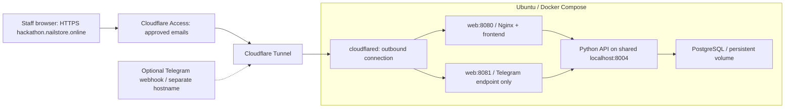

# Host hackathon.nailstore.online on Ubuntu with Cloudflare Tunnel

Your browser address will be **https://hackathon.nailstore.online/**. Docker runs
the app on Ubuntu; a remotely managed Cloudflare Tunnel connects it to your domain.
The existing backend remains bound to localhost inside Docker. No application
Python code, CORS rules, or frontend development settings need changing.

The branch is `feature/frontend` in
[GitHub](https://github.com/lxj17035/Fast-as-Fahhhh2.0/tree/feature/frontend).
This guide prepares the setup; it does not mean the server or Cloudflare account
has already been configured.

## Layout



Cloudflare terminates browser HTTPS and carries requests through the encrypted
tunnel. The final hop is HTTP on the private Docker network. You do not need
Nginx certificates, Certbot, inbound 80/443, or an A record pointing at the server.
See [Cloudflare's tunnel setup](https://developers.cloudflare.com/tunnel/get-started/)
and [routing explanation](https://developers.cloudflare.com/tunnel/concepts/routing/).

The staff site uses Cloudflare Access because the current Sales/PM selector is a
supervised demo control. Access protects entry to the site; it does not implement
per-person PM permissions inside the application. Keep fictional data and the
existing explicit PM approval flow.

## 1. Prepare Ubuntu and the domain

You need an Ubuntu server you can SSH into and administrative access to the
Cloudflare zone `nailstore.online`. Ensure the zone is Active and its nameservers
are set at your registrar. Use Ubuntu 24.04 LTS or 26.04 LTS.

Follow [Docker guide steps 1–3](DOCKER_UBUNTU.md) to install Docker, clone
`feature/frontend`, and create the server's `.env`. If already cloned:

```bash
cd ~/apps/Fast-as-Fahhhh2.0
git switch feature/frontend
git pull --ff-only origin feature/frontend
```

Set POSTGRES_PASSWORD and TELEGRAM_WEBHOOK_SECRET to different random hex values.
Start with AI_PROVIDER=manual and ENABLE_DEMO_APPROVAL=false. Keep actual keys in
the Ubuntu `.env`, with `chmod 600 .env`. Do not upload your Windows Laragon data
directory or copy Windows DATABASE_URL values into the containers.

## 2. Protect the staff hostname with Cloudflare Access first

Configure the access gate **before publishing the hostname**:

1. Open your Cloudflare Zero Trust dashboard. If this is your first use, complete
   the account/team setup shown there.
2. Enable **One-time PIN** under the identity provider/login-method settings, or
   use your existing identity provider.
3. Go to **Access controls → Applications → Add an application** and select a
   **Self-hosted** public-hostname application.
4. Name it `QuoteFlow hackathon`. Set the hostname to exactly
   `hackathon.nailstore.online`, covering the entire hostname, including `/api/*`.
5. Add an **Allow** policy with **Include → Emails** and list only your own and
   authorized teammates' email addresses. Select One-time PIN as a permitted
   login method. A session duration such as 8 hours is suitable for demo sessions.
6. Save the application and policy. Do not add an Everyone/Bypass rule for the
   staff hostname. Test in a private browser window after publishing.

Dashboard wording can vary. Cloudflare documents the
[self-hosted application setup](https://developers.cloudflare.com/learning-paths/clientless-access/access-application/create-access-app/)
and [email policy rules](https://developers.cloudflare.com/cloudflare-one/access-controls/policies/common-policies/).
An OTP login method alone is not an email allowlist; explicitly list the team.

## 3. Create a remotely managed tunnel

1. In the Cloudflare dashboard, open **Networking → Tunnels**. In some layouts,
   this appears under **Networks → Connectors → Cloudflare Tunnels** in Zero Trust.
2. Create a **Cloudflared** tunnel named `quoteflow-hackathon`.
3. Select the **Docker** connector instructions.
4. Copy only the tunnel token from the displayed command. Do not execute the
   dashboard's separate `docker run` command; Compose will run the connector.
5. On Ubuntu, edit your private `.env` and add:

```dotenv
CLOUDFLARE_TUNNEL_TOKEN=PASTE_YOUR_PRIVATE_TUNNEL_TOKEN_HERE
```

Use `nano .env`; do not paste the token into shell commands, chat, or committed
files. This is the tunnel's connector token, not a Cloudflare API key or Telegram
token. The Compose overlay passes it as TUNNEL_TOKEN, an
[official cloudflared run parameter](https://developers.cloudflare.com/tunnel/reference/run-parameters/).

## 4. Start all four containers

Run from the repository root on Ubuntu:

```bash
sudo docker compose -f compose.yaml -f compose.cloudflare.yaml config --quiet
sudo docker compose -f compose.yaml -f compose.cloudflare.yaml up -d --build --force-recreate --wait --wait-timeout 180
sudo docker compose -f compose.yaml -f compose.cloudflare.yaml ps
sudo docker compose -f compose.yaml -f compose.cloudflare.yaml logs --tail=50 cloudflared
curl --fail http://127.0.0.1:8080/api/health
```

Expect healthy db/web/api containers and a running cloudflared container. Its
connection must also appear Healthy/Connected in the Cloudflare dashboard.
Compose `--wait` only checks that cloudflared is running; it cannot confirm the
Cloudflare connection or public route. Check both the dashboard and browser.

Always include **both `-f` options** for operations on this deployment. The base
file alone does not manage cloudflared or load the Telegram-only listener.
The host's localhost:8080 remains available for SSH diagnostics. No port is
published for PostgreSQL, the API, the tunnel, or the webhook-only listener.

Keep inbound SSH available for administration. No inbound web ports or router
port forwarding are required. The tunnel needs outbound connectivity on
port **7844 TCP/UDP**, plus normal DNS and HTTPS access for image pulls and
application providers. See [Cloudflare's firewall requirements](https://developers.cloudflare.com/cloudflare-one/networks/connectors/cloudflare-tunnel/configure-tunnels/tunnel-with-firewall/).

## 5. Route your domain to the app

In the tunnel's **Routes / Published application routes / Public hostnames**,
add this route:

| Field | Value |
| --- | --- |
| Subdomain | `hackathon` |
| Domain | `nailstore.online` |
| Path | Leave blank (all paths) |
| Service type | `HTTP` |
| Service URL | `web:8080` |

The complete origin address is **http://web:8080**. `web` is the Docker Compose
service name. Do not use localhost:8080 here: localhost inside the cloudflared
container refers to cloudflared itself. Do not use https://web:8080; the internal
Nginx listener serves HTTP.

Save the route. Cloudflare's dashboard creates the associated DNS record for
the tunnel. If it reports an existing conflicting `hackathon` record, review and
replace only that record; leave unrelated domain records alone. Do not create an
A record to the Ubuntu IP for this hostname. Ensure the zone's edge certificate
is active, and enable Always Use HTTPS if needed for HTTP-to-HTTPS redirects.

Open **https://hackathon.nailstore.online/** in a private browser window. You
should first see Cloudflare Access, then the QuoteFlow inbox after an approved
email signs in. Verify another unauthorized account is denied. The empty inbox
is normal on a fresh database. Cloudflare login does not select the app's PM role.

If you have custom Cache Everything or transformation rules, bypass caching for
this hostname and keep original request paths. Nginx already returns no-store;
the API and PDF must always reflect the saved quotation version. Do not cache
API responses or PDFs at the edge.

## 6. Optional: allow Telegram receipt through its own restricted hostname

The staff Access page would block Telegram. For a controlled live bot test, use
**hackathon-telegram.nailstore.online** as a separate machine endpoint. The
overlay already adds an Nginx listener on private port 8081 that forwards only
POST requests to `/api/webhooks/telegram`. It does not serve the dashboard or
other API paths. The existing backend verifies the Telegram secret header.

Add a second published route to the same tunnel:

| Field | Value |
| --- | --- |
| Subdomain | `hackathon-telegram` |
| Domain | `nailstore.online` |
| Path | Leave blank |
| Service type | `HTTP` |
| Service URL | `web:8081` |

Do not point this hostname at web:8080. Do not apply the interactive staff Access
login to this webhook hostname; Telegram cannot complete it. Keep the staff
Access application scoped to `hackathon.nailstore.online`. Review any existing
wildcard Access policies and browser challenges so they do not catch this
machine endpoint. Do not disable protection across the whole zone.

The integration owner then registers the bot webhook as:

```text
https://hackathon-telegram.nailstore.online/api/webhooks/telegram
```

Registration must set Telegram's secret_token to the server's private
TELEGRAM_WEBHOOK_SECRET. Use the existing [controlled live verification](LIVE_TEST.md)
with team-owned bot/chat, synthetic records, configured provider keys, and explicit
PM approval. The tunnel does not register the webhook or send any message.

Read-only/unauthenticated checks from your computer:

```bash
# Must be 404: no dashboard on the webhook host.
curl -s -o /dev/null -w '%{http_code}\n' https://hackathon-telegram.nailstore.online/

# Must be 404: no general API access on the webhook host.
curl -s -o /dev/null -w '%{http_code}\n' https://hackathon-telegram.nailstore.online/api/enquiries

# Must be 401 without the secret: proves the existing backend's check is reached.
curl -s -o /dev/null -w '%{http_code}\n' -X POST -H 'Content-Type: application/json' -d '{}' https://hackathon-telegram.nailstore.online/api/webhooks/telegram
```

If these return a Cloudflare challenge/login page, fix the narrow endpoint's
Cloudflare policy before live testing. A 502 or 1033 does not establish receipt.

## 7. Updates, diagnostics, and backups

Use the existing [database backup instructions](DOCKER_UBUNTU.md). The tunnel
does not change the PostgreSQL volume. Keep the server `.env` backed up privately;
rotate the connector token through Cloudflare if it is exposed.

```bash
git pull --ff-only origin feature/frontend
sudo docker compose -f compose.yaml -f compose.cloudflare.yaml pull cloudflared
sudo docker compose -f compose.yaml -f compose.cloudflare.yaml up -d --build --force-recreate --wait --wait-timeout 180
sudo docker compose -f compose.yaml -f compose.cloudflare.yaml ps
```

| Symptom | What to check |
| --- | --- |
| Domain does not resolve | Zone nameservers are active and the tunnel route created the correct DNS record |
| Cloudflare 1033 | Connector token, cloudflared logs, outbound 7844, dashboard connection status |
| Cloudflare 502 | Origin must be HTTP web:8080, with web and api healthy in the same Compose project |
| Docker frontend works over SSH but domain fails | Tunnel route, connector network, DNS and Access policy |
| No email PIN | OTP login enabled; entered email exactly matches the allowed email list |
| HTML returned instead of API JSON | Access session expired or a challenge is intercepting API traffic; sign in again |
| PDF worker blocked | Staff Access must cover the whole hostname; avoid separate asset hosts or public cache rules |
| Telegram webhook denied | Check the second hostname uses web:8081, no interactive Access challenge, and the correct secret header |

## Verification boundary

Local Compose/Nginx/document validation is recorded in
[the implementation checklist](FRONTEND_CHECKLIST.md). Actual Docker execution,
Cloudflare account setup, DNS/HTTPS/Access verification, and live providers must
be checked on the configured server. No real token is committed, no Cloudflare
account is modified, and no live Telegram test is claimed by these files.
