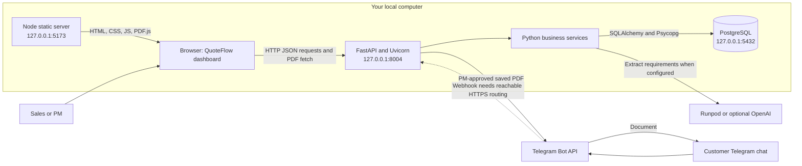
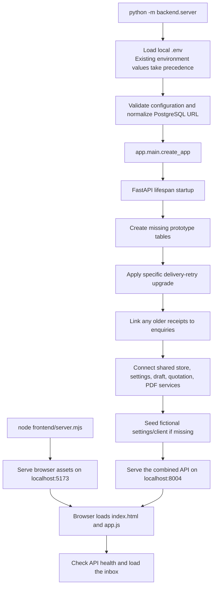
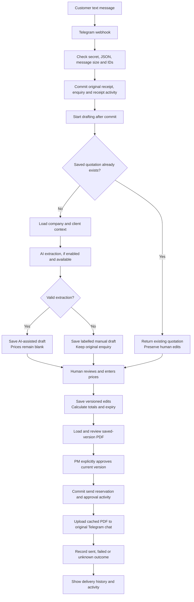
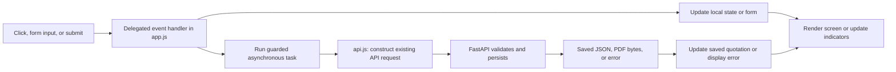
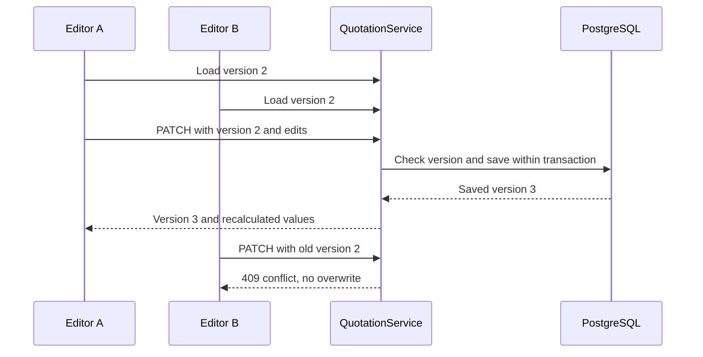
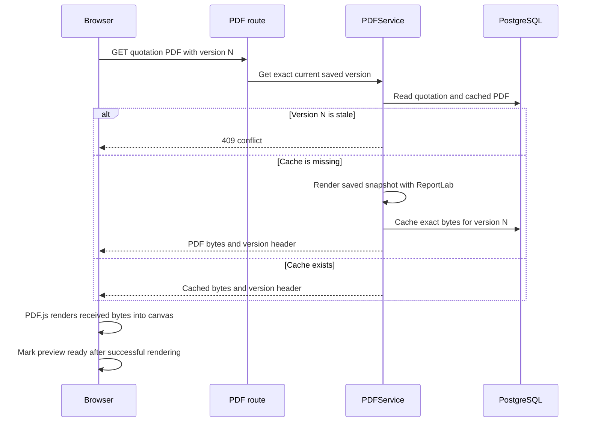
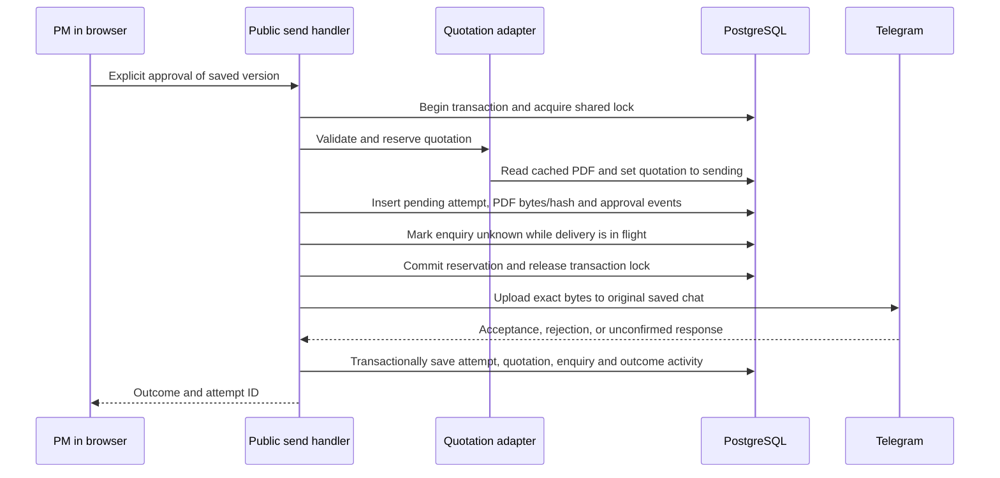
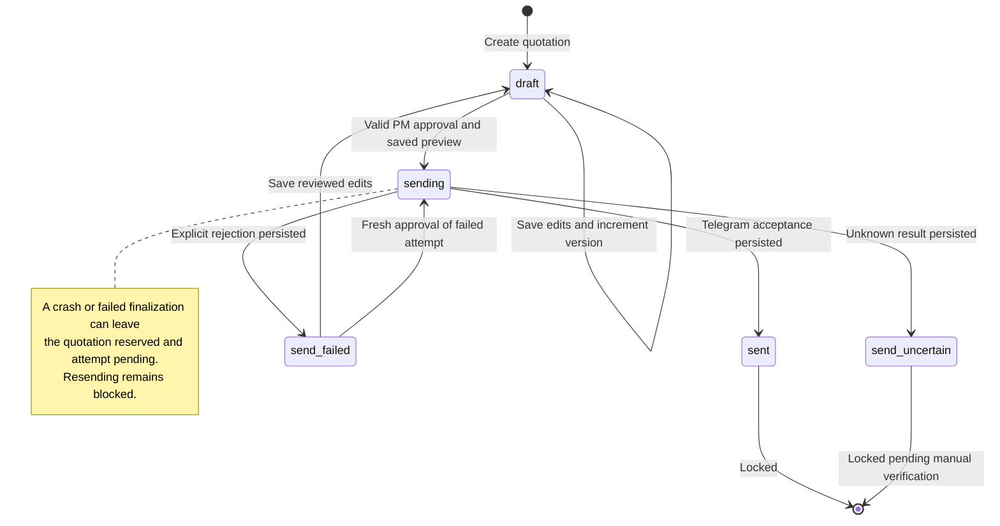
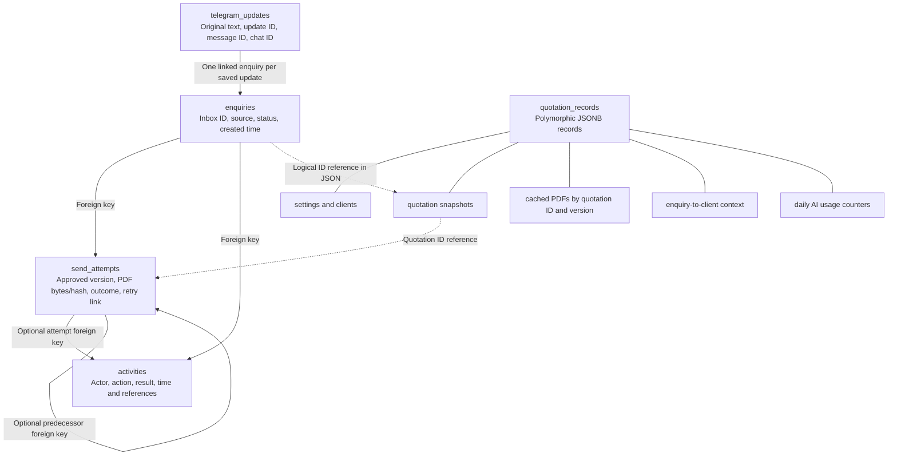

# QuoteFlow: how the code and logic work

This guide explains the implementation in this repository, including the
frontend on `feature/frontend`. Start with sections 1–3 for the overall picture,
then follow a customer enquiry through the remaining sections.

The central rule is: **AI prepares a draft; application code calculates and
validates; a human PM explicitly approves delivery.**

## 1. Overall topology

The project has three local processes: a frontend static server, a Python API,
and PostgreSQL. The browser talks directly to the API. The frontend server only
serves HTML, CSS, JavaScript, and PDF.js resources.



Solid local connections describe the application architecture. The dashed
webhook connection needs separate HTTPS/tunnel or hosting setup: Telegram cannot
reach your computer through a localhost URL alone. Starting the project does not
automatically register a bot webhook or verify live provider credentials.

For the Laragon setup found on this computer:

| Component | Location or address |
| --- | --- |
| Repository | `C:\03-Hackathon\Fast-as-Fahhhh2.0` |
| PostgreSQL executables | `C:\laragon\bin\postgresql\postgresql\bin` |
| PostgreSQL data directory | `C:\laragon\data\postgresql` |
| Dedicated local project database | `quoteflow` |
| Frontend | `http://127.0.0.1:5173` |
| Backend | `http://127.0.0.1:8004` |

Credentials and the generated webhook secret belong only in the ignored local
`.env`; this guide intentionally contains no secret values.

## 2. Folder structure and responsibilities

```text
Fast-as-Fahhhh2.0/
├── frontend/                  Browser interface and its local static server
│   ├── index.html             Loads CSS and the JavaScript application
│   ├── config.js              Public API address
│   ├── server.mjs             Serves allowed frontend/PDF.js files on localhost
│   ├── src/
│   │   ├── app.js             Screens, state, navigation, and user actions
│   │   ├── api.js             HTTP client for the existing backend endpoints
│   │   ├── model.js           Form conversion and frontend approval checks
│   │   ├── pdf-viewer.js      Renders saved backend PDF bytes with PDF.js
│   │   └── styles.css         Desktop, tablet, and mobile layouts
│   └── tests/                 Frontend checks and isolated integration tooling
├── app/                       FastAPI application and integration layer
│   ├── main.py                Constructs and connects the running application
│   ├── telegram.py            Authenticated inbound Telegram webhook
│   ├── database.py            Normalized tables and atomic message receipt
│   ├── automatic_drafting.py  Starts drafting after a receipt is committed
│   ├── enquiries.py           Inbox, original messages, attempts, and history
│   ├── quotation_routes.py    Settings, client, draft, edit, and PDF HTTP routes
│   ├── quotations.py          Supplemental health/demo/quotation/activity routes
│   ├── quotation_contract.py  Saved-quotation delivery interface and types
│   ├── xinjie_store.py        Shared transaction/store integration
│   ├── xinjie_adapter.py      Connects business services to approved delivery
│   ├── delivery.py            Canonical public PM approval and send handler
│   ├── telegram_client.py     Actual outbound Telegram document transport
│   ├── activity.py            Transactional event recording and demo actors
│   ├── config.py              Backend settings loaded from the environment
│   ├── db_url.py              PostgreSQL URL normalization
│   └── migrations.py          Specific additive delivery-retry schema upgrade
├── backend/                   Reusable Python business services
│   ├── server.py              Startup entry point and service composition
│   ├── store.py               PostgreSQL JSON record storage and transactions
│   ├── settings.py            Company and client settings
│   ├── quotations.py          Drafts, money, dates, versions, and state rules
│   ├── drafting.py            Extraction schema, draft service, manual fallback
│   ├── runpod.py              Runpod extraction and shared request budget
│   ├── pdf.py                 ReportLab PDF creation and saved-version cache
│   ├── config.py              Small .env loader
│   ├── errors.py              Shared validation/error helpers
│   └── sending.py             Older compatibility send implementation
├── tests/                     Existing backend regression suite
├── scripts/                   Readiness checks and offline PDF samples
├── docs/                      Requirements, contracts, evidence, and guides
├── .env                       Private local configuration, ignored by Git
└── .input/                    Ignored references and temporary QA artifacts
```

`app/` and `backend/` cooperate inside **one running Python application**. They
are not two independently deployed backend services. `app/` handles HTTP and
Telegram integration; the core quotation services in `backend/` do their work
without depending on browser code or FastAPI request objects.

An important historical distinction: `backend/server.py` still contains a small
standard-library HTTP test harness and an older route dispatcher. However,
`python -m backend.server` starts the combined FastAPI application through
`app.main.create_app()`. The active public send route is `app/delivery.py`.
Do not connect new frontend code to the old body-based send contract in
`backend/sending.py`.

## 3. What happens when you start the project

Backend command, from the repository root:

```powershell
.\.venv\Scripts\python.exe -m backend.server
```

Frontend command, in another terminal from the same folder:

```powershell
node frontend/server.mjs
```



The PostgreSQL database must already exist. Startup creates missing tables and
applies the specific retry upgrade; it is not a general database creation or
schema migration framework. Existing stored settings are not reset on restart.

The `.env` loader reads simple `KEY=value` entries without executing shell
commands. Existing process environment values win over `.env`. Neither the
frontend configuration nor the browser receives database credentials or AI keys.

## 4. The complete enquiry journey



### Message reception: `app/telegram.py` and `app/database.py`

1. Telegram posts to `POST /api/webhooks/telegram`.
2. The handler compares the supplied webhook secret with the configured secret
   before processing the body.
3. Pydantic validates the update, chat ID, message ID, and text. Unsupported
   non-text updates are ignored for this MVP.
4. `save_update()` writes the original message, enquiry, and receipt activity
   together in one transaction. An error rolls all of these writes back.
5. The Telegram update ID is the deduplication key. Receiving the same update
   again cannot replace the stored original text or create another enquiry.
6. A FastAPI background task starts drafting only after the receipt is committed.

Each distinct text update creates a separate enquiry, even in the same chat.
The current MVP does not automatically merge messages into conversations or
identify a returning business client from their Telegram identity.

Original message whitespace is preserved in storage. The drafting service trims
the text it passes into extraction. Provider IDs are serialized as strings so
JavaScript does not lose precision on large integer IDs.

### Automatic drafting: `app/automatic_drafting.py`

`AutomaticDrafting.run(update_id)` finds the saved enquiry and calls the shared
draft service. An in-process active set prevents overlapping automatic work for
the same update in that application instance. Database transactions protect
saved quotation creation as well.

A duplicate receipt can restart drafting that was interrupted, but the draft
service returns any existing quotation. This protects human edits. Automatic
drafting is a small background task, not a durable queue: if the process stops
before work finishes, the committed enquiry still exists and staff can use the
explicit draft endpoint.

## 5. How AI drafting works

The main method is `DraftService.create()` in `backend/drafting.py`.

- It first looks for an existing quotation for the enquiry.
- Unknown Telegram senders receive distinct client records with blank details.
  They are not assigned the fictional seeded client by guessing their identity.
- It loads company settings and the linked client record as extraction context.
- The configured extractor returns a summary, client facts, items, stated
  quantities, and missing-information flags.
- The adapter validates the returned structure and data limits before use.
- The service saves a quotation snapshot and draft-created activity.

| Provider selection | Implementation |
| --- | --- |
| `AI_PROVIDER=runpod` | `backend/runpod.py`, public Chat Completions endpoint |
| `AI_PROVIDER=openai` | `OpenAIExtractor`, Responses API adapter |
| Manual/disabled selection | No external extraction; labelled manual drafting |

If the selection variable is absent, the factory defaults to the OpenAI adapter;
it still requires configured credentials/model. Selecting Runpod does not
silently switch to a different paid provider when Runpod fails.

The extraction schema has no price, recipient, approval, or send-authority
fields. Unexpected output fields are rejected. Unknown names, addresses, and
quantities can remain null. This preserves unknown facts; it does not mean
arbitrary additional AI JSON fields are accepted. Structured validation also
does not prove an extracted fact is correct: the person reviewing the quotation
still checks it against the original message.

On missing configuration, refusal, invalid output, exhausted budget, or a safe
provider failure, the service creates a manual draft with `draftMode: "manual"`
and a safe `draftError` when applicable. It retains the original enquiry. Repeating
draft creation returns that saved draft; it does not regenerate over human work.

Runpod additionally bounds prompt size and output tokens and reserves each
attempt against a shared daily counter stored in PostgreSQL. Failed calls count
toward the budget. There is no automatic network retry or model-repair request.

## 6. How the frontend works

### Entry and navigation

`frontend/index.html` loads `styles.css` and `app.js` as an ES module. The
application uses browser hash routes:

| Browser route | Screen | Render function |
| --- | --- | --- |
| `#/` | Enquiry inbox | `inboxPage()` |
| `#/enquiries/:id` | Quotation review workspace | `reviewPage()` |
| `#/settings` | Business/client settings | `settingsPage()` |

Changing the hash does not require the backend to serve frontend page routes.
`loadRoute()` loads the API data for that view. A request counter prevents a
slow result from an older navigation from replacing the newer screen.



### Saved data versus unsaved edits

The `state` object in `app.js` keeps these concepts separate:

| State | Meaning |
| --- | --- |
| `detail` | Original enquiry, messages, attempts, and activity from the API |
| `quote` | Last saved quotation returned by the server |
| `form` | Editable local copy of quotation fields |
| `dirty` | The form has unsaved changes |
| `busy` | A request is in progress; duplicate actions are disabled |
| `previewVersion` | Which saved version supplied the loaded PDF |
| `pdfReady` | The PDF has successfully rendered into the current canvas |
| `hold` | A delivery request remains unconfirmed |

`editorForm()` creates an editable copy. `captureQuote()` reads input changes.
`quotePatch()` builds only the fields accepted by the backend; it converts blank
quantities/prices to null and preserves explicitly entered zero prices.

While `dirty` is true, the UI labels the total as the **last saved total** and
disables PDF loading and sending. The browser does not calculate the payable
total or expiry itself. `discardEdits()` protects navigation, and a
`beforeunload` handler warns about closing/reloading with unsaved work.

`render()` constructs the interface. Structural changes render the screen again;
typing into the quotation uses `updateEditorIndicators()` to update warnings
without replacing the input and moving the text cursor.

### API adapter and errors

`frontend/src/api.js` is the browser's HTTP boundary. It handles JSON bodies,
optional simulated-role headers, timeouts, PDF responses, and FastAPI error
formats. It never automatically retries a send.

An HTTP 502 containing a recorded `failed` attempt is a known delivery result,
not an unexplained network failure. Similarly, a 503 response containing an
attempt ID and `status: "unknown"` is handled as an uncertain delivery outcome.
Malformed responses cannot be treated as confirmed success.

### Inbox and settings

The inbox loads 25 records per page. Counts, search, and status filters apply to
the loaded page and are labelled accordingly; there is no global search/count
endpoint. Refresh is explicit, so background polling cannot overwrite edits.

Settings updates change the business defaults. Client editing loads an existing
client by ID because the API currently has no client-list endpoint. The client
ID for a Telegram enquiry is shown in its quotation editor.

The Sales/PM selector is visibly simulated. The current editor permits both
roles to prepare quotation fields, including prices. PM retains final approval
responsibility, and the send endpoint enforces the PM role. This is not a secure
production login or a server-enforced PM-only price-editing permission.

Edit attribution is off by default: without an actor header, edit activity has
an unspecified actor. When backend demo approval is enabled, Settings can enable
attribution to the selected simulated role. Sending always submits the explicit
PM header and approval body, and the backend still validates both.

## 7. Quotation rules: the Python source of truth

`QuotationService` in `backend/quotations.py` owns saved quotation behavior.

### Money and missing values

Python `Decimal` performs the calculations. Unit prices support two decimal
places; quantities support three. Quantities must be positive. Explicit prices
must be nonnegative. Each line rounds half-up to two decimals, then the total
sums those rounded line amounts.

```text
Quantity:      20
Unit price:    25.00
Line amount:  500.00
Saved total:  500.00
```

`unitPrice: null` means pricing is unknown and blocks sending. `unitPrice: "0.00"`
means an explicit zero price and can pass the price requirement. A draft can
save incomplete fields; approval requires them to be complete.

### Dates and snapshots

Validity codes are `7d`, `14d`, `1m`, `2m`, and `3m`. Days add calendar days;
months add calendar months and clamp the day when the target month is shorter.
For example, 31 January 2027 plus one month becomes 28 February 2027.

Expiry is valid through the displayed day in Kuala Lumpur. The public send path
also blocks a future issue date. Dates are recalculated by the backend on save.

Creating a quotation copies company settings and client details into a snapshot.
Later changes to the company/client record do not rewrite that quotation. A
person can edit permitted client fields in an editable quotation explicitly.

### Versions and concurrent edits



Every successful edit increments `version`. The expected-version check occurs
inside a transaction. Editable quotation states are `draft` and `send_failed`;
the server rejects edits to sending, sent, or uncertain quotations.

## 8. PDF generation and preview

The backend's `PDFService.get()` reads the saved quotation and checks the
requested version. It looks up cached bytes using a key shaped like
`quotationId:version`. On a cache miss, ReportLab renders the fixed template and
the service stores the bytes as base64 in the JSON record store.



`frontend/src/pdf-viewer.js` displays the actual bytes rather than rebuilding a
similar-looking quotation in HTML. It provides page navigation and local font/
CMap/worker resources. An object URL supports opening the PDF separately. Old
URLs and documents are released when replaced or when leaving the view.

The public send adapter requires an already cached PDF for the approved version.
It does not create a different document at send time. The frontend additionally
requires successful canvas rendering and an explicit human review confirmation.
The server can check that a saved preview exists; simulated identity and cached
bytes do not establish that a person actually read every page.

## 9. PM approval, delivery, and safe retries

The main public handler is `send_quotation()` in `app/delivery.py`.

An initial approval request uses:

```http
POST /api/quotations/:id/send
X-Demo-Actor: pm
Content-Type: application/json
```

```json
{ "expected_version": 2, "approved": true }
```

The backend checks demo approval configuration, actor/role, current version,
editable status, client name, descriptions, quantities, explicit prices,
unresolved information, dates, saved PDF version/bytes, original chat, and
previous attempts. It never accepts a recipient override from the browser.



The network call happens **between** two database transactions. This avoids
holding the database write lock throughout a slow provider request. The durable
pending attempt prevents another request from uploading the document again.

### Quotation state topology



There are three related status systems; their names differ deliberately:

| Observed stage | Quotation status | Attempt status | Inbox enquiry status |
| --- | --- | --- | --- |
| Draft ready for review | `draft` | No attempt | `needs_review` |
| Reserved/in flight | `sending` | `pending` | `unknown` |
| Accepted by Telegram | `sent` | `sent` | `sent` |
| Explicitly rejected | `send_failed` | `failed` | `failed` |
| Outcome uncertain | `send_uncertain` | `unknown` | `unknown` |

Editing a failed quotation resets the quotation to `draft`; the enquiry can
continue to show its last failed delivery outcome until another send result.
The frontend reads attempts rather than assuming that a draft status erases
delivery history.

### Known failure versus unknown outcome

- **Sent:** Telegram accepted the PDF. This is not a customer read receipt.
- **Failed:** The provider explicitly rejected it. A new PM approval may retry
  the currently eligible failed attempt.
- **Unknown/pending:** Delivery may have happened, or processing may be
  interrupted. Automatic retries and ordinary resend are blocked.

A retry adds the exact predecessor ID:

```json
{
  "expected_version": 2,
  "approved": true,
  "retry_of_attempt_id": "the-current-failed-attempt-uuid"
}
```

The new attempt preserves the older attempt and its exact PDF bytes. Unique
indexes prevent duplicate initial sends and multiple successors for one failed
attempt. Replaying an older approval cannot silently turn into another retry.

If Telegram accepts the PDF but saving the outcome fails, finalization rolls
back. The already committed reservation stays pending and blocks another send;
the application does not invent a successful delivery event.

The browser also records an ambiguous-request hold in session storage. It
survives reloads in the same session and cannot be cleared by an older failed
attempt. The database remains the protection across different browsers or
application instances. There is no forced-resend or unknown-outcome recovery
endpoint in this MVP.

## 10. Database topology and transaction protection



`quotation_records` is one table distinguished by `kind` and `id`, with a JSONB
body in PostgreSQL. Boxes beneath it are record categories, not extra SQL tables.
Dashed links above are application-level references; do not assume every JSON
reference has a SQL foreign-key constraint. Compatibility/history records can
also remain in this table.

`backend/store.py` provides `get`, `list`, `put`, and `transaction`. Mutations
require a transaction. Its inbound adapter reads normalized Telegram rows and
linked client context without duplicating the original messages.

For prototype mutations, code consistently acquires an engine-scoped Python
lock and then a PostgreSQL transaction-scoped advisory lock. This serializes
version checks, saves, previews, draft creation, and send reservations across
the relevant integrated paths. A shared lock order avoids edit/send deadlocks.
Database uniqueness constraints also arbitrate receipt and send duplicates.

`app/xinjie_store.py` adapts these services to the shared connection and converts
Telegram draft-created events into canonical activity rows. `app/xinjie_adapter.py`
implements the saved-quotation delivery contract using the real quotation
services and cached bytes. These adapters are why the merged modules share one
database and one approval transaction.

## 11. Activity history

`app/activity.py` inserts canonical events inside the same transaction as the
associated database mutation. Examples include:

```text
telegram_received
enquiry_created
quotation_draft_created
quotation_updated
pm_approved
pdf_send_attempted
pdf_send_succeeded / pdf_send_failed / delivery_unknown
```

Events carry linked IDs, version/attempt where relevant, UTC time, actor origin,
action, and result. The frontend formats times for Kuala Lumpur. Actor origin
distinguishes system work, simulated human roles, and unspecified actors.

An activity-write failure rolls back its associated mutation. Activity does not
copy raw provider error messages, private tokens, or customer message text.
Older missing events are not reconstructed as if they had been recorded.

The application exposes read APIs and inserts new events; it has no activity
edit/delete endpoint. This is application-level append-only behavior, not a
claim that a privileged database administrator cannot change records.

## 12. API map and where to start reading

| User action | Endpoint | Main code |
| --- | --- | --- |
| Check connection | `GET /api/health` | `app/quotations.py` |
| Receive customer text | `POST /api/webhooks/telegram` | `app/telegram.py` |
| Load inbox/detail | `GET /api/enquiries` and `/:id` | `app/enquiries.py` |
| Load enquiry quotation | `GET /api/enquiries/:id/quotation` | `app/quotations.py` |
| Create missing draft | `POST /api/enquiries/:id/draft` | `app/quotation_routes.py` |
| Read/save quotation | `GET/PATCH /api/quotations/:id` | `app/quotation_routes.py` |
| Load saved PDF | `GET /api/quotations/:id/pdf?version=N` | `app/quotation_routes.py` |
| Approve delivery | `POST /api/quotations/:id/send` | `app/delivery.py` |
| Read activity | Enquiry detail or activity-only routes | `app/enquiries.py`, `app/quotations.py` |
| Read/save company | `GET/PATCH /api/settings` | `app/quotation_routes.py` |
| Read/save existing client | `GET/PATCH /api/clients/:id` | `app/quotation_routes.py` |

Enquiry/activity responses use snake_case, while quotation payloads use
camelCase. Quotation services commonly use hexadecimal UUID strings; integrated
delivery/activity uses canonical hyphenated UUID strings. Route adapters and
the frontend's `sameId()` normalize these representations where needed.

A useful source-reading order is:

1. `frontend/src/app.js`: trace `loadRoute()`, form submit, preview, and approval.
2. `frontend/src/api.js`: follow each browser action to its endpoint.
3. `app/main.py`: see how services, shared storage, and routers are connected.
4. `app/telegram.py` and `backend/drafting.py`: follow reception into drafting.
5. `backend/quotations.py`: understand money, dates, versions, and locked states.
6. `backend/pdf.py`: see snapshot rendering and the versioned cache.
7. `app/delivery.py` and `app/xinjie_adapter.py`: follow reservation and upload.
8. `app/database.py`, `backend/store.py`, and `app/activity.py`: inspect persistence.

## 13. Tests, local startup, and live integration are different

| Environment | Database | Providers | What it establishes |
| --- | --- | --- | --- |
| Normal local project | PostgreSQL through `DATABASE_URL` | Real only when configured and invoked | Normal persisted application behavior |
| Existing portable tests | Temporary SQLite adapters | Mocked | Repeatable logic/API regressions |
| PostgreSQL test run | Disposable database through `TEST_DATABASE_URL` | Mocked | Real driver, JSONB, locking, and database behavior |
| Frontend QA fixture | Temporary SQLite under ignored `.input/` | Injected synthetic extract/send | Safe browser review without credentials |
| Controlled live journey | Team-controlled PostgreSQL/bot/chat | Configured live providers | Actual receipt, extraction and PM-approved delivery |

SQLite is explicitly injected test infrastructure; runtime configuration does
not fall back to it. The optional frontend QA fixture uses the actual FastAPI
code, but its provider responses are synthetic and its storage is disposable.
It must not be mistaken for a verified live Telegram demonstration.

Useful commands from the repository root:

```powershell
# Frontend API, model, and static-server checks
node --test frontend/tests/*.test.mjs

# Shipped JavaScript API client against an isolated real FastAPI instance
node frontend/tests/integration.mjs

# Existing backend suite; set TEST_DATABASE_URL only to a disposable test DB
.\.venv\Scripts\python.exe -m pytest -q

# Optional browser review fixture, instead of the normal backend on port 8004
.\.venv\Scripts\python.exe -m frontend.tests.preview_backend
```

The recorded frontend implementation checks passed 14 frontend tests and 7
real-API checks with mocked providers. Its portable backend run passed 274 tests
with 2 PostgreSQL-only skips. These are recorded verification results, not a
new test run performed merely by writing this guide.

The later Laragon startup verified a PostgreSQL connection plus successful
frontend, health, inbox, and settings HTTP responses. That startup did not
register a Telegram webhook, send a message, run AI, or rerun the PostgreSQL
regression suite. An empty inbox means there are no saved Telegram enquiries
in that database yet; the browser does not insert imaginary customer records.

Further references:

- [Product workflow](WORKFLOW.md)
- [Frontend setup and safe QA](../frontend/README.md)
- [Frontend implementation handoff](FRONTEND.md)
- [Current PM approval and retry contract](PM_APPROVAL.md)
- [PostgreSQL setup and storage](POSTGRESQL.md)
- [Controlled live Telegram verification](LIVE_TEST.md)
