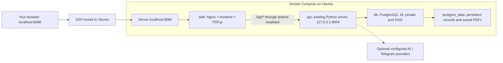

# Run QuoteFlow on Ubuntu with Docker

This deploys the existing Python backend, frontend, and PostgreSQL on an Ubuntu
server. No Python application code is changed. Use a fresh Ubuntu 24.04 LTS or
26.04 LTS server, a sudo-capable SSH account, and access to this Git repository.
Python, Node, pnpm, PostgreSQL, and Laragon do not need installing on that server;
the images supply the application runtimes and database.

The supplied setup is a **private, supervised demo**. Access it through SSH.
The existing Sales/PM selector is simulated and is not a login. Following the
repository's `AGENTS.md`, neither the dashboard nor the database is published to
the internet. No domain name or HTTPS certificate is needed for SSH access.

## Topology



| File | Purpose |
| --- | --- |
| `Dockerfile` | Python API image, running as an unprivileged application user |
| `frontend/Dockerfile` | Installs pinned PDF.js from the lockfile; serves assets with Nginx |
| `compose.yaml` | Starts web, API, and PostgreSQL, with readiness checks and persistent storage |
| `.dockerignore` | Allows source/build inputs only; excludes `.env`, databases, and local files |
| `deploy/nginx.conf` | Serves the frontend and forwards API requests without retrying sends |
| `deploy/frontend-config.js` | Uses the page's own origin for API requests |

The API uses `network_mode: service:web` to share Nginx's network namespace.
This preserves the existing backend's localhost binding: Nginx can reach it at
`127.0.0.1:8004`, but no API port is published. The shared network can reach
PostgreSQL using `db:5432`. Docker Compose supports this namespace sharing and
database readiness dependencies; see [Compose services](https://docs.docker.com/reference/compose-file/services/).

The browser calls `/api/...` on the same address as the dashboard. It must never
call a server-side `localhost:8004` address from a remote computer. This Docker
configuration replaces only the image's public frontend config; local development
still uses `frontend/config.js` and the existing Node server.

## 1. Connect to Ubuntu and install Docker

From your Windows PowerShell terminal, replace the user and server address:

```powershell
ssh ubuntu@YOUR_SERVER_IP
```

The following commands run **inside Ubuntu**, not PowerShell. On a fresh server,
install Docker Engine and the Compose plugin using Docker's official APT
repository. If Docker is already installed, check `sudo docker version` and
`sudo docker compose version` before changing its installation. Existing
conflicting installations need the migration steps in the
[official Ubuntu installation guide](https://docs.docker.com/engine/install/ubuntu/).

```bash
sudo apt-get update
sudo apt-get install -y ca-certificates curl git openssl
sudo install -m 0755 -d /etc/apt/keyrings
sudo curl -fsSL https://download.docker.com/linux/ubuntu/gpg -o /etc/apt/keyrings/docker.asc
sudo chmod a+r /etc/apt/keyrings/docker.asc

sudo tee /etc/apt/sources.list.d/docker.sources > /dev/null <<EOF
Types: deb
URIs: https://download.docker.com/linux/ubuntu
Suites: $(. /etc/os-release && echo "${UBUNTU_CODENAME:-$VERSION_CODENAME}")
Components: stable
Architectures: $(dpkg --print-architecture)
Signed-By: /etc/apt/keyrings/docker.asc
EOF

sudo apt-get update
sudo apt-get install -y docker-ce docker-ce-cli containerd.io docker-buildx-plugin docker-compose-plugin
sudo systemctl enable --now docker
sudo docker run --rm hello-world
sudo docker compose version
```

Keep using `sudo docker ...` in this guide. You do not need to add your account
to the Docker group. A recent Compose plugin is required (`depends_on.restart`
requires at least Compose 2.17).

## 2. Get your reviewed branch onto the server

Review the changes and push `feature/frontend` from your own computer first.
These files are committed locally; Codex has not pushed them.

Then run on Ubuntu:

```bash
mkdir -p ~/apps
cd ~/apps
git clone --branch feature/frontend --single-branch https://github.com/lxj17035/Fast-as-Fahhhh2.0.git
cd Fast-as-Fahhhh2.0
git branch --show-current
```

If the repository is private, use your normal GitHub SSH authentication instead.
Do not put a token into a clone URL or committed config.

## 3. Create the server's private configuration

Create a **new server `.env`**, leaving an existing file alone:

```bash
umask 077
if [ ! -e .env ]; then
    cp .env.example .env
fi
chmod 600 .env
nano .env
```

Set the following values in the editor. Generate separate password/secret values
with `openssl rand -hex 32`, then paste them into `.env`. Do not paste real values
into Git, screenshots, or team documentation.

```dotenv
POSTGRES_PASSWORD=REPLACE_WITH_RANDOM_HEX_FROM_OPENSSL
TELEGRAM_WEBHOOK_SECRET=REPLACE_WITH_A_DIFFERENT_RANDOM_HEX
WEB_PORT=8080
AI_PROVIDER=manual
ENABLE_DEMO_APPROVAL=false
TELEGRAM_BOT_TOKEN=
RUNPOD_API_KEY=
OPENAI_API_KEY=
```

Use a hex database password: Compose interpolates it into a PostgreSQL URL, so
characters such as `@`, `/`, `#`, or `$` must not appear in this example setup.
Both required values must be nonblank. The webhook secret is required at startup
even if no bot is configured. Keep it to letters, digits, `_`, or `-`.

Leave `DATABASE_URL` blank in this **server** `.env`. Compose explicitly builds
the API URL using `db:5432`, the `quoteflow` database/user, and POSTGRES_PASSWORD.
The Windows Laragon URL, Windows drive paths, and `localhost:5432` do not belong
in this container configuration. Compose passes only listed application values,
and `.env` is never copied into either image.

`AI_PROVIDER=manual` starts without external AI requests. To enable the existing
Runpod integration later, set `AI_PROVIDER=runpod` and `RUNPOD_API_KEY` privately.
For a supervised team send test, configure the team bot token and set
`ENABLE_DEMO_APPROVAL=true`. Saving or previewing never sends; explicit PM approval
is still required. See the Telegram limits below before expecting inbound messages.

## 4. Build and start

From `~/apps/Fast-as-Fahhhh2.0` on Ubuntu:

```bash
# Validate without printing resolved secret values.
sudo docker compose config --quiet

# Build images and wait for all three health checks.
sudo docker compose up -d --build --wait --wait-timeout 180

sudo docker compose ps
curl --fail http://127.0.0.1:8080/healthz
curl --fail http://127.0.0.1:8080/api/health
curl --fail http://127.0.0.1:8080/config.js
```

Expect healthy `db`, `web`, and `api` containers. The config response should use
`API_BASE_URL = ''`. Database tables and synthetic default business settings are
initialized by the existing application startup. No manual SQL migration or
Windows virtual environment is required. A first build needs internet access
to fetch base images, Python packages, and frontend dependencies.

If WEB_PORT is different, substitute it in curl commands and the SSH tunnel.
Do not use `docker compose config` without `--quiet` in shared logs: the expanded
configuration contains credentials.

## 5. Open the frontend from your computer

Open a **second PowerShell terminal on Windows** and keep this command running:

```powershell
ssh -N -o ExitOnForwardFailure=yes -L 127.0.0.1:8088:127.0.0.1:8080 ubuntu@YOUR_SERVER_IP
```

Open **http://127.0.0.1:8088/** in your browser. Local port 8088 forwards to the
server's 8080. Using a different local port avoids your existing Windows frontend
on 5173. Stop the tunnel with Ctrl+C when finished. You only need inbound SSH
access to the server; do not open 5432, 8004, or 8080 in its cloud firewall.

The first inbox can be empty: Docker does not copy Laragon records or QA fixtures.
An empty inbox does not mean PostgreSQL or the UI failed. Configure a controlled
Telegram receipt path to populate the actual Telegram inbox.

## 6. Telegram and public hosting limits

The private SSH tunnel is for staff access. Telegram cannot deliver webhooks to
it. Hosting containers by itself does not register a bot webhook or prove the
live Telegram/AI journey works.

A live receive test additionally needs a reachable HTTPS endpoint for
`POST /api/webhooks/telegram`, configured with the same private secret and a
team-controlled bot/chat. Keep the dashboard and all other API routes private.
Have the integration owner configure a restricted HTTPS ingress for that single
route and follow [the controlled live test](LIVE_TEST.md). This deployment does
not configure a public ingress, register a webhook, or send a test message.

A public staff dashboard needs an approved access-control design first. The
repository explicitly excludes production identity from this MVP, so this guide
does not expose the simulated PM role selector at a public IP/domain.

## 7. Updates, restarts, storage, and backups

PostgreSQL stores records and versioned PDFs in Docker's named volume
`quoteflow_postgres_data`. Images and containers can be rebuilt without losing
that volume. This is a fresh server database; existing Laragon data is not migrated.

Before an update, back up the database on Ubuntu:

```bash
umask 077
mkdir -p output/backups
chmod 700 output/backups
sudo docker compose exec -T db pg_dump -U quoteflow -d quoteflow -Fc > "output/backups/quoteflow-$(date -u +%Y%m%dT%H%M%SZ).dump"
```

Check the command succeeds and the file is nonempty before proceeding. Keep a
private copy off the server as well; backup files may contain application data.
For restore, use PostgreSQL's `pg_restore` into a separate, empty database and
verify it before switching application configuration. Do not overwrite an active
database as an untested recovery step.

Update the reviewed branch, then recreate the complete stack so the API rejoins
Nginx's current network namespace:

```bash
git pull --ff-only origin feature/frontend
sudo docker compose up -d --build --force-recreate --wait --wait-timeout 180
sudo docker compose ps
curl --fail http://127.0.0.1:8080/api/health
```

Routine commands:

```bash
# Status and recent diagnostics. Review locally; do not share secrets or messages.
sudo docker compose ps
sudo docker compose logs --tail=100 api web db

# Stop or restart the whole stack; preserve the database volume.
sudo docker compose stop
sudo docker compose start

# Remove containers/network while keeping the named database volume.
sudo docker compose down
sudo docker compose up -d --wait --wait-timeout 180
```

Do not add `-v` to `down`: it deletes the database volume. Do not run volume prune
as routine maintenance. Changing POSTGRES_PASSWORD in `.env` does not change the
password inside an already initialized PostgreSQL volume; password rotation needs
a coordinated database change and API reconfiguration. Back up before upgrades.
The PostgreSQL major version stays at 16; major upgrades require a migration.

## Troubleshooting

| Symptom | Check |
| --- | --- |
| Compose requires POSTGRES_PASSWORD or webhook secret | Set nonblank values in the server `.env` in the repository root |
| Database authentication fails | Use the original volume's password; editing `.env` alone cannot reset it |
| API exits at startup | Inspect API logs locally; verify db health and the required secret format |
| API returns 502 through Nginx | API may still be starting; check `compose ps` and logs; recreate the full stack if web was replaced alone |
| Browser cannot connect | Confirm the SSH tunnel is running, local 8088 is free, and the server's WEB_PORT matches |
| Browser tries `localhost:8004` | Build `frontend/Dockerfile`, verify `/config.js`, and reload the browser; do not serve the development config |
| PDF worker fails | Verify `/vendor/pdfjs/build/pdf.worker.mjs` loads with a JavaScript MIME type; rebuild web after asset changes |
| Inbox is empty | Fresh database has no Telegram enquiries; live webhook delivery is a separate setup |
| PM send disabled | Check ENABLE_DEMO_APPROVAL, PM role, saved details, current PDF preview, and unresolved delivery history |

## Verification record

Deployment files and the guide are prepared locally on `feature/frontend`.
Record local configuration/test results in [the frontend checklist](FRONTEND_CHECKLIST.md).
A Docker image build, container startup, server SSH session, and live provider
checks require a Docker-enabled Ubuntu host and are not implied by static checks.

References: [Docker Ubuntu installation](https://docs.docker.com/engine/install/ubuntu/),
[Compose networking](https://docs.docker.com/compose/how-tos/networking/),
[Compose startup order](https://docs.docker.com/compose/how-tos/startup-order/),
[official PostgreSQL image](https://hub.docker.com/_/postgres), and
[official Nginx image](https://hub.docker.com/_/nginx).
