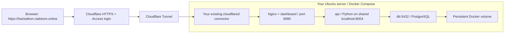

# Step-by-step: Docker on Ubuntu → Cloudflare Tunnel → dashboard

## Your target

Open **https://hackathon.nailstore.online/** from your computer and reach the
QuoteFlow dashboard running on your Ubuntu server.

This is a standalone guide. Docker and your Cloudflare Tunnel are already set up;
the `hackathon.nailstore.online` hostname route still needs adding. Reuse the
existing tunnel and its actual name. Follow the numbered
steps in order; you do not need to install Python, Node, pnpm, PostgreSQL, or
Laragon on Ubuntu. Docker supplies the application runtimes and database.

| Item | Value |
| --- | --- |
| Repository | `https://github.com/lxj17035/Fast-as-Fahhhh2.0.git` |
| Branch | `feature/frontend` |
| Server project directory | `~/apps/Fast-as-Fahhhh2.0` |
| Website | `https://hackathon.nailstore.online/` |
| Cloudflare tunnel name | Your existing tunnel's name; no new tunnel required |
| Tunnel's origin service | HTTP on port **8080**; choose the address in step 6 |
| Database | PostgreSQL 16 in Docker |

The dashboard retains simulated Sales/PM roles. Cloudflare Access limits entry
to your team; it does not assign PM authority inside the app. Use this as a
supervised demo with fictional customer data.



There are three places where you will work:

- **Your computer:** SSH into Ubuntu and later open the website in your browser.
- **Ubuntu SSH terminal:** run every `bash` block below.
- **Cloudflare dashboard:** complete the explicitly labelled browser steps.

Do not paste the complete document into a terminal. Run one command block at a
time, check its result, then continue.

## 1. Connect to your Ubuntu server

**On your computer**, replace the username and IP address with your SSH details:

```powershell
ssh ubuntu@YOUR_SERVER_IP
```

For a server that uses an SSH key:

```powershell
ssh -i "C:\Users\YOUR_WINDOWS_USER\.ssh\YOUR_KEY" ubuntu@YOUR_SERVER_IP
```

Use whichever login method already works for your server. Once connected, the
following commands run on Ubuntu:

```bash
whoami
pwd
cat /etc/os-release
```

Expected: your Linux username and Ubuntu version. Your Windows project directory
and Laragon installation are not used by the server.

## 2. Verify your existing Docker installation

**On Ubuntu:**

```bash
sudo docker version
sudo docker compose version
sudo systemctl is-active docker
```

Expected:

- Docker shows both Client and Server information.
- `docker compose` reports a version. Use a recent Compose plugin supporting
  `up --wait` and `depends_on.restart` (at least Compose 2.17).
- The service is `active`.

If Docker is installed but stopped:

```bash
sudo systemctl enable --now docker
```

If only the Compose plugin is missing and Docker's official APT repository is
already configured:

```bash
sudo apt-get update
sudo apt-get install -y docker-compose-plugin
sudo docker compose version
```

If APT cannot find that package, follow the repository configuration in
[Docker's official Ubuntu instructions](https://docs.docker.com/engine/install/ubuntu/)
before installing the plugin. You do not need to reinstall a working Docker Engine.

Install the small command-line tools used by this guide:

```bash
sudo apt-get update
sudo apt-get install -y git curl openssl nano
```

## 3. Download the project

For the **first installation** on this server:

```bash
mkdir -p ~/apps
cd ~/apps
git clone --branch feature/frontend --single-branch https://github.com/lxj17035/Fast-as-Fahhhh2.0.git
cd Fast-as-Fahhhh2.0
```

If that project directory already contains the repository, use this instead of
cloning again:

```bash
cd ~/apps/Fast-as-Fahhhh2.0
git status --short
git switch feature/frontend
git pull --ff-only origin feature/frontend
```

If Git reports local edits or a conflict, review them before continuing; do not
reset or delete existing files to force an update. For a private repository, use
your existing GitHub SSH access rather than putting a token in the clone URL.

Check the branch and required files:

```bash
git branch --show-current
ls -l Dockerfile frontend/Dockerfile compose.yaml compose.cloudflare.yaml
ls -l deploy/nginx.conf deploy/nginx-webhook.conf deploy/frontend-config.js
```

Expected branch: `feature/frontend`. All listed files must exist.

## 4. Create the Ubuntu server's private .env

Stay inside `~/apps/Fast-as-Fahhhh2.0`. This block creates a new `.env` only if
one does not already exist. It generates two different private random values
directly into the file, without printing them:

```bash
umask 077
if [ ! -e .env ]; then
    cat > .env <<EOF
POSTGRES_PASSWORD=$(openssl rand -hex 32)
TELEGRAM_WEBHOOK_SECRET=$(openssl rand -hex 32)
WEB_PORT=8080
DATABASE_URL=
AI_PROVIDER=manual
ENABLE_DEMO_APPROVAL=false
TELEGRAM_BOT_TOKEN=
RUNPOD_API_KEY=
OPENAI_API_KEY=
CLOUDFLARE_TUNNEL_TOKEN=
COMPOSE_FILE=compose.yaml
EOF
fi
chmod 600 .env
nano .env
```

If `.env` already existed, review it in nano and ensure it has these entries:

```dotenv
POSTGRES_PASSWORD=YOUR_PRIVATE_RANDOM_HEX_PASSWORD
TELEGRAM_WEBHOOK_SECRET=YOUR_DIFFERENT_PRIVATE_RANDOM_HEX_SECRET
WEB_PORT=8080
DATABASE_URL=
AI_PROVIDER=manual
ENABLE_DEMO_APPROVAL=false
CLOUDFLARE_TUNNEL_TOKEN=
COMPOSE_FILE=compose.yaml
```

The uppercase values above are explanations, not passwords to copy. To generate
replacement values when setting up a new database, run `openssl rand -hex 32`
separately for each field and paste the results privately into nano.

In nano: **Ctrl+O**, **Enter** saves; **Ctrl+X** exits.

What these settings mean:

| Setting | What to do |
| --- | --- |
| POSTGRES_PASSWORD | Keep the generated hex value; the API and database use it together |
| TELEGRAM_WEBHOOK_SECRET | Required for API startup even before Telegram is configured |
| DATABASE_URL | Leave blank here; Compose supplies the private `db:5432` connection |
| WEB_PORT | Keep 8080 for the diagnostics commands below |
| AI_PROVIDER | `manual` starts the dashboard without paid AI requests |
| ENABLE_DEMO_APPROVAL | Keep false until a supervised team send test is configured |
| CLOUDFLARE_TUNNEL_TOKEN | Needed only if this project's Compose starts the connector; an existing external connector keeps its own credentials |
| COMPOSE_FILE | Select the files for your connector arrangement in step 6; base app only by default |

Keep `.env` on the server and out of Git, chat, and screenshots. Do not copy the
Windows Laragon DATABASE_URL: the database lives in a Docker service named `db`.
Do not change POSTGRES_PASSWORD after the database volume has been initialized
without also rotating the password in PostgreSQL.

## 5. Reuse Cloudflare and protect the new dashboard hostname

**In your browser, open the Cloudflare dashboard.**

### 5.1 Check your domain

Select the `nailstore.online` zone and confirm its status is **Active**. If it is
already active, leave its nameservers and existing records unchanged. If the zone
has not been added/activated yet, complete that domain setup first. An existing
tunnel alone does not create or activate your domain's DNS zone.

You will use `hackathon.nailstore.online`. For this tunnel setup you do not need
an A record pointing the hostname at the Ubuntu server IP.

### 5.2 Reuse or add the staff Access application

Check **Access controls → Applications** for an existing application covering
`hackathon.nailstore.online`. If it exists, review its hostname and team email
allowlist and keep using it. Do not create a duplicate or remove other apps.
If this hostname has no Access application, complete these steps before publishing it:

1. Open **Zero Trust / Cloudflare One**. Complete the team/account setup if it is
   your first visit.
2. In identity provider/login-method settings, enable **One-time PIN**, or use
   your already configured identity provider.
3. Open **Access controls → Applications → Add an application**.
4. Select a **Self-hosted** application and add a public hostname.
5. Name it `QuoteFlow dashboard`.
6. Set the hostname to **hackathon.nailstore.online**. Leave the path blank so
   the protection covers the whole site, including API and PDF requests.
7. Add an **Allow** policy. Under **Include → Emails**, enter your own email
   address and the exact email addresses of authorized teammates.
8. Permit the One-time PIN login method and save the application/policy.

Do not use an Everyone or Bypass policy for this staff hostname. Selecting the
OTP login method alone does not restrict who can sign in; the email allowlist
does that. This is an external gate for the demo, not a change to Python roles.

Cloudflare's menu wording may differ slightly. References:
[create an Access application](https://developers.cloudflare.com/learning-paths/clientless-access/access-application/create-access-app/)
and [email access policies](https://developers.cloudflare.com/cloudflare-one/access-controls/policies/common-policies/).

## 6. Reuse your existing tunnel and identify its connector

**In the Cloudflare dashboard:**

1. Open **Networking → Tunnels**. Some accounts show this under
   **Networks → Connectors → Cloudflare Tunnels** in Zero Trust.
2. Open the tunnel you already created. Keep its existing name and other routes.
3. Check its connector status. If connected, reuse the running connector instead
   of installing another copy. Do not rotate its token or delete the tunnel.
4. The hostname route for this project will be added in step 9.

**On Ubuntu**, these read-only commands help identify how it runs:

```bash
systemctl is-active cloudflared
sudo docker ps --format 'table {{.Names}}\t{{.Image}}\t{{.Networks}}'
```

`active` from the first command normally means a host service. A cloudflared
image in the second command means a Docker connector. An inactive/not-found
service is not an application failure if the connector is in Docker.

Choose **one** matching case below. Port 8080 alone does not identify the case.

### Case A: cloudflared already runs as a service on this Ubuntu server

Keep that service and its credentials unchanged. Edit the project's `.env`:

```bash
cd ~/apps/Fast-as-Fahhhh2.0
nano .env
```

Set:

```dotenv
COMPOSE_FILE=compose.yaml
```

Leave CLOUDFLARE_TUNNEL_TOKEN blank; the application does not need your existing
connector's token. Step 7 starts three app containers. In step 9 use
**HTTP `127.0.0.1:8080`** because cloudflared is on the same Ubuntu host.

### Case B: cloudflared already runs in a different Docker container on this server

Keep the existing container. Set `COMPOSE_FILE=compose.yaml` in the project's
`.env`; no tunnel token is needed by this app. Step 7 starts three app containers.

Check the connector's network mode, replacing the example container name with
the actual name printed above:

```bash
sudo docker inspect --format '{{.HostConfig.NetworkMode}}' YOUR_EXISTING_CLOUDFLARED_CONTAINER
```

If it says `host`, use **HTTP `127.0.0.1:8080`** in step 9.
If it uses a Docker bridge network, first complete step 7, then attach that
specific existing connector to the app's network:

```bash
sudo docker network connect quoteflow_default YOUR_EXISTING_CLOUDFLARED_CONTAINER
```

If it is already connected, do not attach it again. Use **HTTP `web:8080`** in
step 9. Its other networks remain attached, so existing routes can keep working.
This network attachment survives a normal container restart. If that connector
is later recreated, reconnect it or persist this extra external network in its
own Compose configuration. Every connector replica serving this tunnel must be
able to reach the same origin; do not add a second connector with different
reachability and assume all traffic will use the right one.

### Case C: use this project's Docker connector, or retain it if already running

If this project's `quoteflow-cloudflared-1` connector already runs, keep it and
its existing token; do not install another connector. Otherwise, use this case
only when the existing tunnel still needs a connector on the server.
Let this project's Compose manage cloudflared. In the existing
tunnel's connector installation/Add replica instructions, select Docker and copy
the connector token privately. Do not create another tunnel. Set these values
in the Ubuntu project's `.env` using `nano .env`:

```dotenv
COMPOSE_FILE=compose.yaml:compose.cloudflare.yaml
CLOUDFLARE_TUNNEL_TOKEN=YOUR_PRIVATE_EXISTING_TUNNEL_TOKEN
```

Step 7 starts four containers. Use **HTTP `web:8080`** in step 9.
The colon separator is for Ubuntu/Linux. Do not paste a token in chat or shell
commands. If there are active connectors on other machines, verify they can
reach this origin too before adding a replica; use a connector with the right
network access rather than disrupting another site's working tunnel.
These cases describe your initial connector arrangement. Do not switch a running
Case C deployment to A/B while leaving its old connector active unintentionally.

### How the following commands select the right files

Run the remaining `sudo docker compose ...` commands from the project root.
Compose reads `COMPOSE_FILE` from `.env`, selecting either the three-service app
or the app plus connector overlay. This saves repeating different `-f` flags.
See [Docker's COMPOSE_FILE reference](https://docs.docker.com/compose/how-tos/environment-variables/envvars/).

Cloudflare documents the Docker connector in its
[tunnel setup guide](https://developers.cloudflare.com/tunnel/get-started/)
and the token environment variable in
[run parameters](https://developers.cloudflare.com/tunnel/reference/run-parameters/).

## 7. Build and start the project

**On Ubuntu, from the project directory:**

```bash
cd ~/apps/Fast-as-Fahhhh2.0

# Validate the selected configuration without printing secret values.
sudo docker compose config --quiet

# Build and start the selected services in the background.
sudo docker compose up -d --build --wait --wait-timeout 180

# Inspect the result.
sudo docker compose ps
```

The first build can take several minutes while images and packages download.
`--wait-timeout` applies to service readiness; it is not a build-time estimate.

Expected containers:

| Service | Expected state | Purpose |
| --- | --- | --- |
| db | Running / healthy | Persistent PostgreSQL storage |
| web | Running / healthy | Nginx, dashboard, and PDF.js assets |
| api | Running / healthy | Existing Python API |
| cloudflared | Running in Case C only | Cases A/B reuse the connector outside this project |

If a command fails, inspect the relevant service before proceeding:

```bash
sudo docker compose logs --tail=100 db
sudo docker compose logs --tail=100 api
sudo docker compose logs --tail=100 web
```

For the tunnel, check its existing service/container's logs in Cases A/B.
Use `sudo docker compose logs --tail=100 cloudflared` only in Case C.

Review logs locally; do not share credentials or customer content. Do not run
`docker compose config` without `--quiet` in shared logs because it expands secrets.

## 8. Verify the app locally on Ubuntu

Before testing the public domain, check the server-side app:

```bash
curl --fail http://127.0.0.1:8080/healthz
curl --fail http://127.0.0.1:8080/api/health
curl --fail http://127.0.0.1:8080/config.js
curl --fail -I http://127.0.0.1:8080/
curl --fail -I http://127.0.0.1:8080/vendor/pdfjs/build/pdf.worker.mjs
```

Expected results:

- `/healthz` returns `ok`.
- `/api/health` returns HTTP 200 with the backend's JSON health response.
- `/config.js` includes `export const API_BASE_URL = '';`.
- `/` returns HTTP 200 and an HTML content type.
- The PDF worker returns HTTP 200 with a JavaScript content type.

The empty API base is correct: the browser calls the same domain's `/api/...`,
and Nginx forwards that to the Python API. Do not change it to localhost:8004
or a Docker service name in the browser configuration.

Now check your existing tunnel connector in Cloudflare. It should show **Healthy / Connected**.
A running cloudflared container alone does not prove that its token or connection
works; inspect its logs and the dashboard state.

## 9. Connect the subdomain to the dashboard

**In Cloudflare, open your existing tunnel using its actual name.**

Go to **Routes / Published application routes / Public hostnames**, then add a
published application for this hostname. If this hostname route already exists,
edit that route rather than creating another. Leave all other routes unchanged.

| Field | Value to enter |
| --- | --- |
| Subdomain | `hackathon` |
| Domain | `nailstore.online` |
| Path | Leave blank |
| Service type | **HTTP** |
| Service URL | **127.0.0.1:8080** for Case A or host-network Case B; **web:8080** for bridge-network Case B or Case C |

If the interface has a single complete service address field, enter:

```text
http://127.0.0.1:8080
```

The address above is for the existing host service. For the Docker network cases
identified in step 6, enter `http://web:8080` instead. Both use port 8080.

Save the route. With a normal Cloudflare-managed DNS zone, the dashboard creates
the tunnel's DNS record. If it reports that `hackathon` already has a conflicting
record, inspect whether it already points to this tunnel. Keep a correct existing
record; change only a conflicting record for this hostname before saving again.
There is no need to create an A record pointing at your server. See
[Cloudflare routing](https://developers.cloudflare.com/tunnel/concepts/routing/).

Why this exact address matters:

- `127.0.0.1` reaches the host's published localhost port from a host connector.
- `web` is the Nginx container's service name on the app's Docker network.
- `8080` is Nginx's port inside Docker.
- `localhost:8080` inside a bridge-network connector would point at cloudflared
  itself, so it is only appropriate for host/host-network connectors.
- `https://web:8080` is incorrect because this internal listener uses HTTP.
- The external browser URL still uses HTTPS through Cloudflare.

Confirm the zone's edge SSL certificate is active. Enable **Always Use HTTPS**
for the intended hostname if you need HTTP visits redirected to HTTPS. Do not
add a Cache Everything rule: API responses and versioned PDF previews need the
latest saved data. Review any existing custom cache rules for this hostname.

## 10. Open your dashboard

**On your own computer**, open a private/incognito browser window and visit:

```text
https://hackathon.nailstore.online/
```

Expected sequence:

1. Cloudflare Access asks for your approved email address.
2. You receive a one-time login code, or use the configured identity provider.
3. After signing in, the QuoteFlow enquiry inbox opens.
4. The app shows Connected, and Settings opens successfully.

Check an unapproved account is denied. The entire hostname should be protected,
not only the homepage. A command-line request to the public API without an Access
session can return a login redirect or denial instead of JSON; use step 8 for
the origin API health check.

A new database normally has an empty Telegram inbox. Starting the website does
not copy Windows/Laragon records, create fake inbox rows, register a Telegram
webhook, or send a message. You can visit the dashboard successfully before
configuring AI and Telegram.

## 11. Network and persistence details

The tunnel makes outbound connections, so this setup does not need inbound
80/443, inbound 8080, or router port forwarding. Keep your existing SSH access
for administration; do not change SSH/firewall settings blindly.

If outbound traffic is restricted, allow the tunnel's required **7844 TCP/UDP**
connections and normal DNS/HTTPS needed for Docker image downloads and providers.
Use [Cloudflare's firewall requirements](https://developers.cloudflare.com/cloudflare-one/networks/connectors/cloudflare-tunnel/configure-tunnels/tunnel-with-firewall/)
for the current destination list.

PostgreSQL data and saved PDFs live in the named volume
**quoteflow_postgres_data**. Rebuilding containers preserves that volume. Do not
run `down -v` or volume-prune commands as routine maintenance; they can destroy
the database. The server starts with a separate database from Laragon.

## 12. Commands for normal maintenance

Always run these from the repository root. The `COMPOSE_FILE` value selected in
step 6 determines which services Compose manages; retain it in the private `.env`.

### Check status and recent logs

```bash
cd ~/apps/Fast-as-Fahhhh2.0
sudo docker compose ps
sudo docker compose logs --tail=100
```

### Back up before updating

```bash
cd ~/apps/Fast-as-Fahhhh2.0
umask 077
mkdir -p output/backups
chmod 700 output/backups
sudo docker compose exec -T db pg_dump -U quoteflow -d quoteflow -Fc > "output/backups/quoteflow-$(date -u +%Y%m%dT%H%M%SZ).dump"
ls -lh output/backups
```

Check pg_dump exits successfully and the file is nonempty. Keep a private off-server
copy. For recovery, restore into a separate empty database and verify it before
switching the application; do not overwrite active records as a first experiment.

### Pull reviewed project updates and rebuild

```bash
cd ~/apps/Fast-as-Fahhhh2.0
git status --short
git pull --ff-only origin feature/frontend
sudo docker compose up -d --build --force-recreate --wait --wait-timeout 180
sudo docker compose ps
curl --fail http://127.0.0.1:8080/api/health
```

Recreating the complete stack keeps the API joined to Nginx's current shared
network namespace. Avoid recreating only web in isolation.
In Case C only, you can run `sudo docker compose pull cloudflared` before the
rebuild to update that connector image. Cases A/B keep their existing connector's
update process; this project does not replace or stop it.

### Stop and start without deleting the database

```bash
sudo docker compose stop
sudo docker compose start
```

Closing SSH does not stop these detached containers. Restart policies are set
to `unless-stopped`; after a server reboot, check Docker is active, all services
are running, and the Cloudflare connector is healthy. A manually stopped service
may need starting again.

### After editing .env

```bash
sudo docker compose up -d --force-recreate --wait --wait-timeout 180
```

This applies new container environment values. Changing a database password in
`.env` does not rotate an existing database's stored password. Coordinate that
change separately and keep backups.

## 13. Troubleshooting

| Problem | Check or action |
| --- | --- |
| `docker: command not found` | Docker is unavailable in this server session; confirm you are SSH'd into the correct host |
| `docker compose` not recognized | Install/update the Compose plugin in step 2 |
| Permission denied on Docker socket | Use the `sudo docker ...` commands shown here |
| POSTGRES_PASSWORD or webhook secret required | Review `.env` in the repository root; both values must be nonblank |
| CLOUDFLARE_TUNNEL_TOKEN required | Case C requires the existing connector token; Cases A/B should select only `COMPOSE_FILE=compose.yaml` |
| Database password authentication failed | Verify the original initialized volume's password; do not erase the volume to fix a config typo |
| API unhealthy | Read `api` and `db` logs; confirm database health and webhook-secret format |
| Local port 8080 already allocated | Check `sudo ss -ltnp 'sport = :8080'`; choose a free WEB_PORT in `.env` and adjust curl commands. Host connectors must use that new host port; Docker-network connectors keep `web:8080` |
| Cloudflare 1033 / tunnel disconnected | Check connector logs, token, and outbound network connectivity |
| Cloudflare 502 | Confirm HTTP plus the correct origin from step 6: host `127.0.0.1:8080`, or Docker-network `web:8080`; check origin health and connector reachability |
| Domain does not resolve | Check zone activation, the exact hostname, and the tunnel DNS record |
| SSL/certificate error | Check Cloudflare's edge certificate is active for the hostname |
| No login code or access denied | Check OTP login settings and the exact email allowlist |
| API returns HTML after some time | Access session may have expired; sign in again before retrying normal reads |
| Empty inbox | Fresh database has no Telegram enquiries; website hosting can still be working |
| Browser calls localhost:8004 | Verify `/config.js` contains the empty API base, rebuild the Docker frontend, and reload |

To collect diagnostics locally:

```bash
cd ~/apps/Fast-as-Fahhhh2.0
sudo docker compose ps
sudo docker compose logs --tail=100 api web
curl --fail http://127.0.0.1:8080/api/health
```

Review/redact logs before sharing them. Do not share the contents of `.env`.

## 14. Optional later work: AI and Telegram

Your requested hosting outcome is complete when the domain opens the protected
dashboard and its API connection works. AI/Telegram provider setup is a separate
integration step; keep the required credentials private.

When ready, follow [the optional Telegram hostname instructions](CLOUDFLARE_UBUNTU.md)
and [controlled live verification](LIVE_TEST.md). The existing overlay supports
`hackathon-telegram.nailstore.online` → HTTP `web:8081`, an endpoint-only listener,
so Telegram does not need to pass the staff's interactive login.
That overlay example assumes the connector shares the app's Docker network.
Do not change Cases A/B to Case C just to enable Telegram: the host-only base
setup does not publish a webhook listener, and its ingress needs a separate,
reviewed configuration. Dashboard hosting does not depend on that integration.

## Completion check

- [ ] The Ubuntu repository is on `feature/frontend`.
- [ ] Server `.env` is private, contains the generated database/webhook secrets, and selects the right COMPOSE_FILE; only Case C needs the tunnel token here.
- [ ] db, web, and api are healthy; the reused cloudflared connector is connected in Cloudflare.
- [ ] Local `/api/health` returns HTTP 200.
- [ ] The route is `hackathon.nailstore.online` → HTTP port 8080, using the host or Docker address selected in step 6.
- [ ] An approved user can sign in and visit the dashboard; an unapproved user is denied.
- [ ] The dashboard shows Connected and Settings opens.

These are actions to perform on your server/account. Writing this guide does not
claim that Docker images, Cloudflare DNS/Access, or the live domain were deployed
or verified remotely. The backend source is unchanged.
