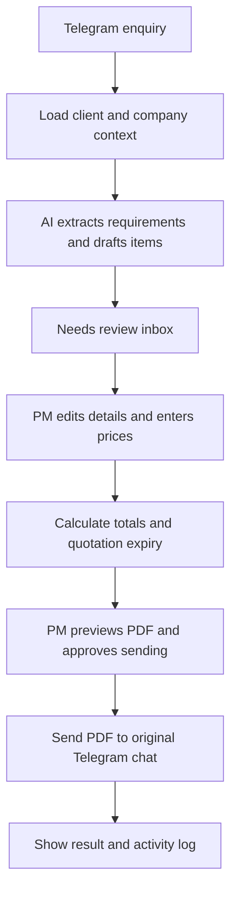

# Essential workflow

## Problem and audience

Malaysian micro and small businesses can miss enquiries or spend time copying messages into quotations. Our product assists the sales team with drafting and tracking; the PM retains control of pricing and sending.

The first demo uses one fictional printing business and fictional customer enquiries. Keep real customer/company records out of the prototype.

V2 B1 extends the backend to three fictional profiles (Printing, Cleaning,
Repair) with one manually selected active profile. New enquiries retain their
profile for life; switching profiles changes the demo workspace scope without
moving existing records. See [business profile contract](BUSINESS_PROFILES.md).
F1 adds explicit profile selection in Business settings; selection changes the
shared demo workspace. Remaining V2 conversation/review UI is separate work.

## One complete journey

| Challenge step | What we demonstrate |
| --- | --- |
| Trigger | A team member sends a fictional customer enquiry to our Telegram bot |
| Connected data | Join the message with a seeded fictional client, company profile, and quotation defaults |
| Decision logic | AI drafts requirements; normal application rules calculate totals and expiry and flag missing fields |
| Human approval | Only the simulated PM role can approve and send; Sales can prepare drafts |
| Visible outcome | PDF appears in the source chat; the dashboard shows the result and records the action |

Telegram is the transport, not proof of advertising attribution. Store the source as Telegram; do not claim to know which advertisement generated it.

## Build now

1. **Inbox:** enquiry reference, Telegram source, original messages, and Needs review/Sent/Failed status.
2. **Connected business data:** fictional client details, company identity, currency, and validity default. Show which values came from messages and which came from stored settings.
3. **AI draft:** requirement summary, item descriptions, stated quantities, and missing information. Leave prices blank; never invent missing facts. Use one fixed PDF layout rather than AI-generated executable templates.
4. **Quotation editor:** editable client name/address, items, quantities, manual unit prices, issue date, calculated expiry, and total.
5. **Preview and approval:** show the current saved PDF; PM explicitly clicks Approve and send. Changes after preview require a refreshed preview.
6. **Send and record:** send to the saved Telegram chat; show success, failure, or unknown outcome and record the actor/action/time.
7. **Simple role demonstration:** Sales can view and edit drafts; PM can also approve/send. A clearly labelled simulated role selector is sufficient for the controlled prototype, not secure production access control.

The inbox is the required PM alert. Email is useful if time remains, but must not delay the working approval journey.

## Quotation rules to retain

- Default validity: one calendar month. Options: 7 days, 14 days, 1 month, 2 months, 3 months.
- PM chooses the issue date. Add calendar days/months; clamp month-end dates. Example: 31 January 2027 + 1 month = 28 February 2027.
- Show the expiry date explicitly; valid through that date in Asia/Kuala_Lumpur time.
- Copy settings and client/company details into the quotation. Later changes must not alter a sent PDF.
- Require client name, item description, positive quantity, and an explicitly entered nonnegative price. Leave unknown address blank.
- Calculate totals on the backend using decimal arithmetic or integer minor units. One currency; no tax/discount engine.
- Block sending when required data is missing or the quotation has expired. AI must never approve or send.

## Minimal screens

| Screen | Content |
| --- | --- |
| Inbox | Enquiries, source, status, open detail |
| Review | Messages, connected context, editable quotation, PDF preview, PM approval, activity log |
| Settings | Fictional company details, currency, default validity, editable client details |

## Orbyte fit and reuse

Position this as an enquiry-to-quotation module inside an Orbyte-style connected business hub. Assume the hub supplies business context and user roles; our module contributes drafting, review, and quotation delivery. Do not claim access to real Orbyte APIs or an existing integration.

For the prototype, seed fictional context and document the assumed interface. Reuse the same workflow for a printer, repair shop, or service provider by changing company details and item descriptions. Explain future per-business data isolation and hub-provided permissions; do not build multi-tenant infrastructure now. This adds a sales capability rather than duplicating HR/admin functions.

## Benefit and SDG evidence

Measure manual preparation and assisted preparation on the same fictional enquiries. Record elapsed time, number of copy/paste steps, and errors in client fields, dates, or totals. Report observed results separately from targets; do not invent savings or claim eliminated missed enquiries from a short demo.

Proposed target to test: at least 30% less quotation preparation time, with all outgoing quotations PM-approved. Run three paired trials if time allows. Ask a teammate unfamiliar with the UI to complete a review without formal training and note where they struggle.

Explain the contribution to SDG 8, especially productivity through technology (8.2) and support for small enterprises (8.3). This is an intended contribution, not a measured social-impact claim.

## Boundaries

Use synthetic business/customer data and team-controlled test channels. Simulated identities/roles are for a supervised demo only. In the pitch, briefly identify future privacy work: notice/consent where applicable, limited data collection, access controls, retention/deletion, and review against Malaysia's PDPA before deployment. This is a future-work statement, not a compliance claim.

Defer WhatsApp/Instagram/Facebook, real Orbyte integration, production identity, multi-tenancy, analytics dashboards, model training, attachments/voice, payments, statutory filings, and legal/financial advice. Optional validation or a business-model sentence can strengthen the pitch; neither needs a new feature.

Source: supplied Domain 2 PDF, physical pages 2-7. Requirements are summarized here; implementation choices are ours.
